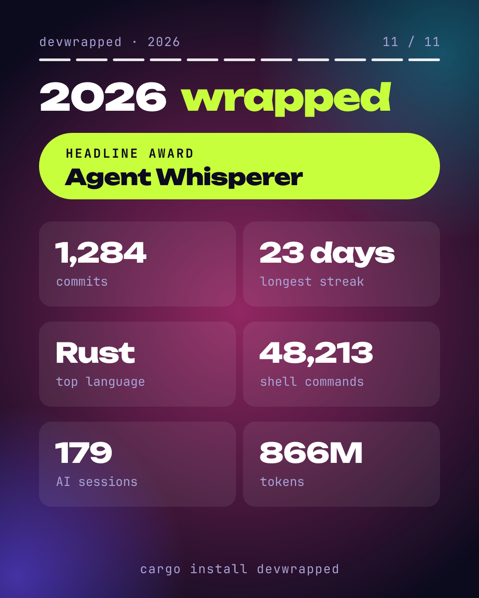
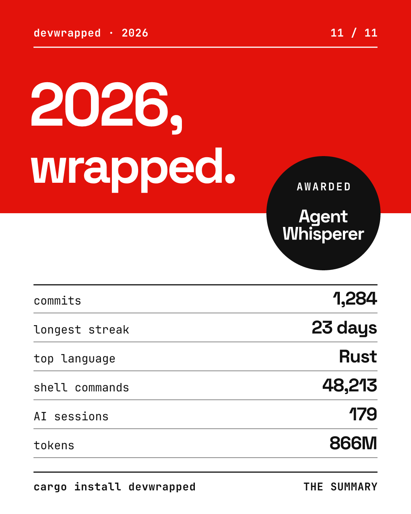
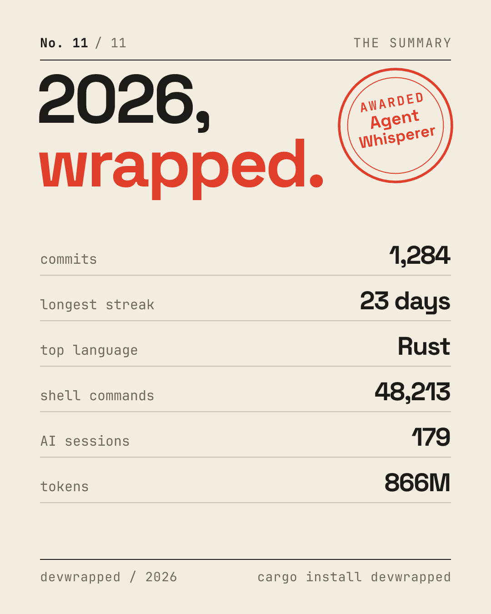
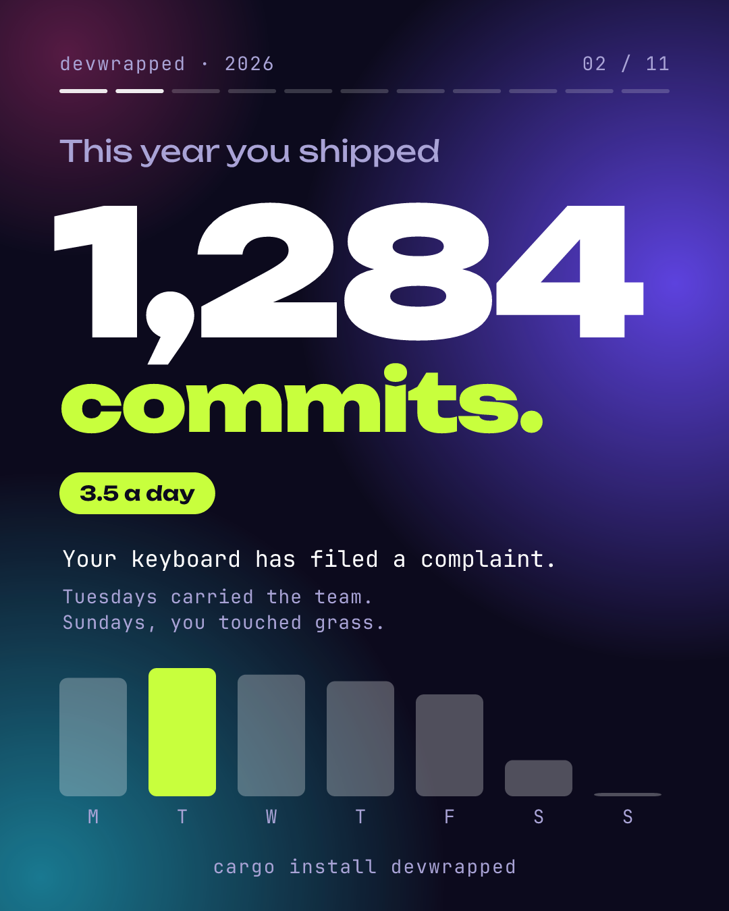
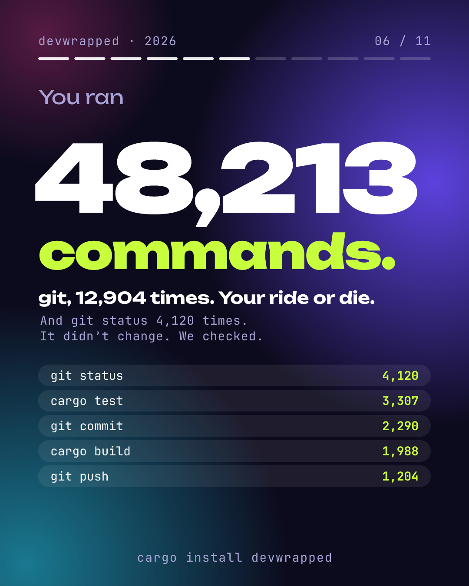

<div align="center">

# devwrapped

Your year in code, wrapped: devwrapped turns your git history, shell history, and AI agent logs into a set of shareable slides, without anything leaving your machine.

[](https://crates.io/crates/devwrapped)
[](https://github.com/OBERON-gg/devwrapped/actions/workflows/ci.yml)
[](#license)





*The summary slide in the night, poster, and paper themes, made from built-in sample data.*

[Demo](https://oberon-gg.github.io/devwrapped/) · [Install](#install) · [Usage](#usage) · [Privacy](#privacy)

</div>

## Quick start

```
cargo install devwrapped
devwrapped
```

The first command installs devwrapped. The second prints your year so far in the terminal. To also write the slides, add `--format all`.

To see it before it reads anything of yours, run `devwrapped --sample`. It uses built-in data and opens no files.

## What you get

**A summary in your terminal.** It lists which sources were found, then your numbers for each one.


**A set of slides to share.** Each slide is 1080 x 1350 px, sized for social feeds. A year gets up to 11: intro, commits, streak, languages, peak hour, shell, typo, agents, tokens, award, and a summary. Slides without data are left out.





**A story you can click through.** The HTML output plays every slide in 1 file. Tap, click, or use the arrow keys. The file holds its own fonts and has no external links, so it works offline. The [demo page](https://oberon-gg.github.io/devwrapped/) plays the sample story.

## What it reads

| Source | What counts |
| --- | --- |
| Git | Your commits in every repository under your home folder |
| Shell history | bash, zsh, fish, and PowerShell commands |
| Claude Code | Sessions, tool uses, models, and tokens |
| Codex CLI | Sessions, tool uses, models, and tokens |

Everything is read on your machine, and only counts are kept. devwrapped has no network code. The [privacy section](#privacy) has the details.

## Install

With Rust installed:

```
cargo install devwrapped
```

Or download a binary from the [releases page](https://github.com/OBERON-gg/devwrapped/releases). There are builds for Windows x86_64, Linux x86_64, and macOS aarch64.

Windows and Linux are supported. macOS is best-effort: CI builds and tests it, and bugs get fixed when people report them.

## Usage

Print this year's summary:

```
devwrapped
```

Write the slides as PNG files in a new folder:

```
devwrapped --format png --out-dir wrapped
```

Make every format in the paper theme for 2025:

```
devwrapped --format all --theme paper --since 2025-01-01 --until 2025-12-31
```

### Options

| Option | Meaning |
| --- | --- |
| `--format <list>` | Outputs to make, separated by commas: `term`, `svg`, `png`, `html`, or `all`. The default is `term`. |
| `--theme <name>` | `night`, `poster`, or `paper`. The default is `night`. |
| `--clock <12\|24>` | Show times like `3 p.m.` or `15:00`. The default follows your system setting. |
| `--out-dir <path>` | Folder for the files. It is created when missing. The default is the current folder. |
| `--since <date>` | First day to include, as YYYY-MM-DD. The default is January 1 of this year. |
| `--until <date>` | Last day to include. The default is today. |
| `--root <path>` | Folder to scan for git repositories in place of your home folder. Can be repeated. |
| `--email <email>` | Count commits by this author email as yours. Can be repeated. |
| `--skip <source>` | Leave out `git`, `shell`, `claude`, or `codex`. A skipped source is never opened. Can be repeated. |
| `--show-repo-names` | Show the folder names of your 5 most active repositories, and add a slide for them. They are hidden by default. |
| `--sample` | Use built-in synthetic data and read nothing. |

### Files

- SVG and PNG write 1 file per slide, from `devwrapped-2026-01-intro.png` to `devwrapped-2026-11-summary.png`.
- HTML writes 1 file, `devwrapped-2026.html`.
- The terminal summary turns off color when `NO_COLOR` is set or the output is not a terminal.

### Themes

`night` is dark, with glowing color. `poster` is a Swiss poster in red, black, and white. `paper` is an editorial zine on cream, with hand-drawn marks.

## Awards

Each year gets a headline award: the first one in this table that applies. The award slide also shows up to 2 more.

| Award | Rule |
| --- | --- |
| Agent Whisperer | An average of 5 or more AI agent sessions per day with agent activity, and 50 or more in all |
| Night Owl | 25% or more of your activity between 00:00 and 05:00 |
| Early Bird | 20% or more of your activity between 05:00 and 08:00 |
| Holiday Shipper | A commit on December 25 or January 1 |
| Daily Driver | Commits on 200 or more days |
| Streak Keeper | Commits on 14 or more days in a row |
| Weekend Warrior | 35% or more of your activity on Saturday or Sunday |
| Hands Off | An average of 40 or more agent tool uses per session, over 10 or more sessions |
| Agent Juggler | Both Claude Code and Codex CLI, each with 20% or more of your sessions |
| Big Bang | An average of 20 or more changed files per commit, over 10 or more commits |
| Polyglot | 5 or more languages, each with 5% or more of your changed files |
| Typo Champion | 25 or more typos, making up 1% or more of your shell commands |
| Status Checker | `git status` is 25% or more of your git commands, with 100 or more uses |
| Specialist | 1 language with 90% or more of your changed files |
| Steady Shipper | None of the above |

Activity means commits, dated shell commands, and agent session starts. Night Owl, Early Bird, and Weekend Warrior need at least 100 of them. A typo is a command name or subcommand 1 edit away from a known one, such as `gti` or `git stauts`.

Some sources hold less than a year. Claude Code keeps about 30 days of logs by default, and shell history files have a size limit. That is why the agent and typo awards use rates instead of totals.

## Privacy

Shell history and agent logs can hold passwords, tokens, and private text. devwrapped treats all of it as sensitive.

- **No network.** The binary makes no network calls, and `cargo deny` bans HTTP, socket, and DNS crates in CI.
- **Git:** it keeps commit times, file extensions, and the number of changed files. It never keeps commit messages, file names, diffs, or emails.
- **Shell history:** it keeps the command name and a known subcommand, and drops all arguments while it reads each line. A name shows only when it is a known tool, an installed program, a PowerShell cmdlet, or a typo of a known name. A password typed alone on a line counts as `other`.
- **Agent logs:** it keeps timestamps, tool names, model names, and token counts. It never reads prompts, responses, file contents, or paths.
- **Output:** it never prints repository paths or branch names. Records it cannot read are skipped and counted, never printed.

[PRIVACY.md](PRIVACY.md) lists exactly what each source reads and keeps, and how to report a privacy bug.

## Good to know

Some numbers depend on what each tool records:

- bash writes timestamps only when `HISTTIMEFORMAT` is set, and PowerShell never does. Commands without a date count in the shell totals for any range, but not in the hour, weekday, or award numbers.
- Claude Code deletes its logs after about 30 days unless `cleanupPeriodDays` is raised in its settings. Raise it early in the year to keep a full year of sessions.

<details>
<summary>Where devwrapped looks for each source</summary>

<br>

| Source | Files |
| --- | --- |
| Git | Repositories up to 4 folders below your home folder or each `--root`. Hidden folders, `node_modules`, and `target` are skipped. Your emails come from `user.email` and `author.email` in the git config. |
| bash | `~/.bash_history`, or `$HISTFILE` |
| zsh | `~/.zsh_history`, `~/.histfile`, `$ZDOTDIR/.zsh_history`, or `$HISTFILE` |
| fish | `~/.local/share/fish/fish_history`, or under `$XDG_DATA_HOME` |
| PowerShell | The PSReadLine history files in `%APPDATA%\Microsoft\Windows\PowerShell\PSReadLine` on Windows and `~/.local/share/powershell/PSReadLine` on Linux |
| Claude Code | `~/.claude/projects`, or under `$CLAUDE_CONFIG_DIR` |
| Codex CLI | `~/.codex/sessions`, or under `$CODEX_HOME` |

</details>

## Contributing

Bug reports and fixes are welcome. [CONTRIBUTING.md](CONTRIBUTING.md) explains how to build and test. Please don't paste real history or logs into issues.

## License

devwrapped is licensed under either of [MIT](LICENSE-MIT) or [Apache-2.0](LICENSE-APACHE), at your option.

The bundled fonts are JetBrains Mono, Unbounded, and Space Grotesk, under the SIL Open Font License. Their license files are in [crates/devwrapped-card/fonts](crates/devwrapped-card/fonts).
